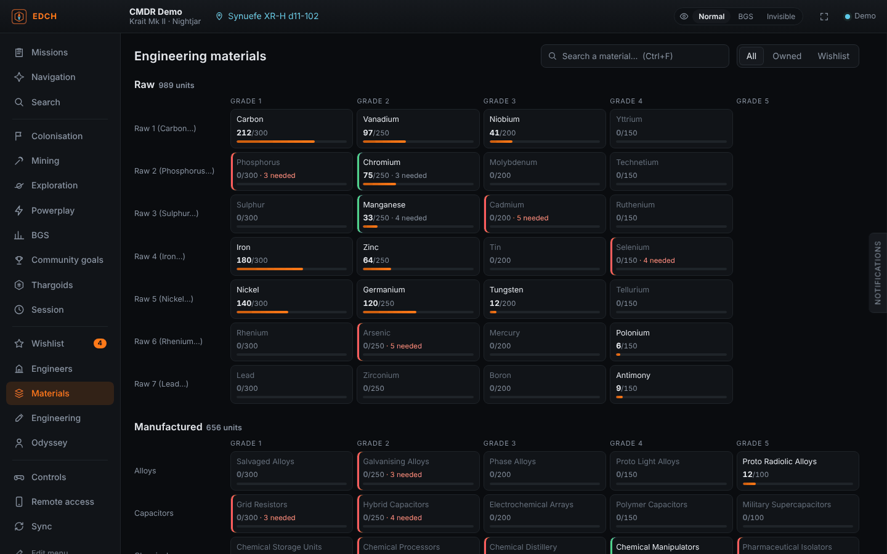
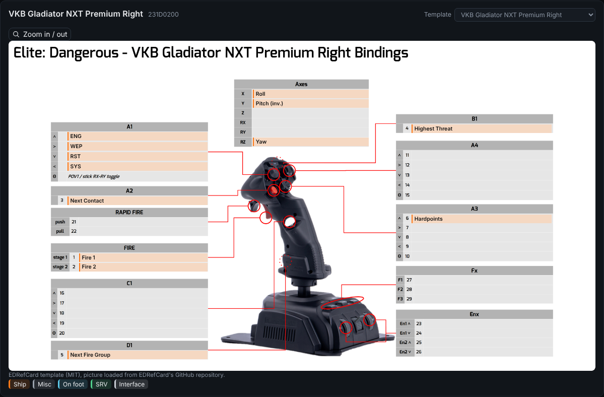
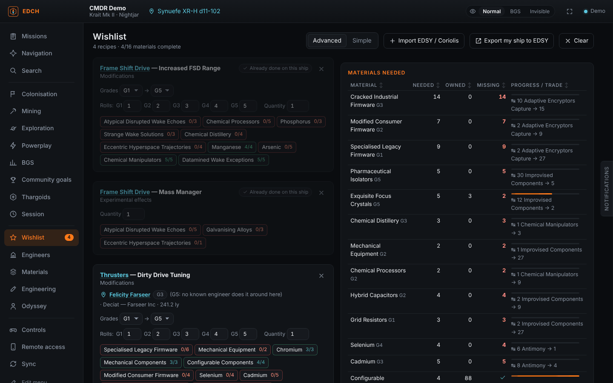
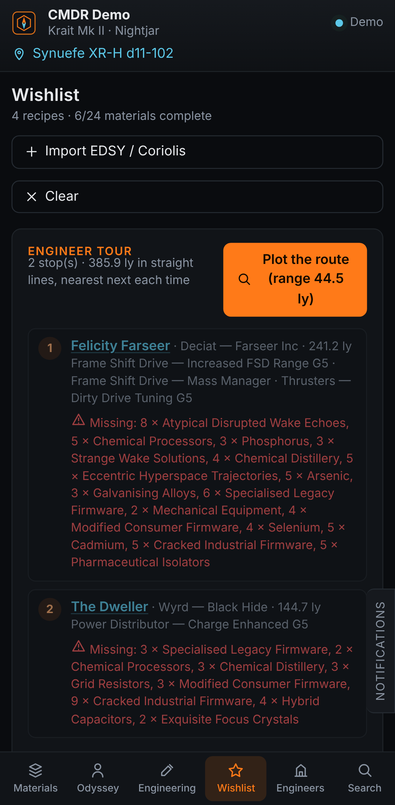
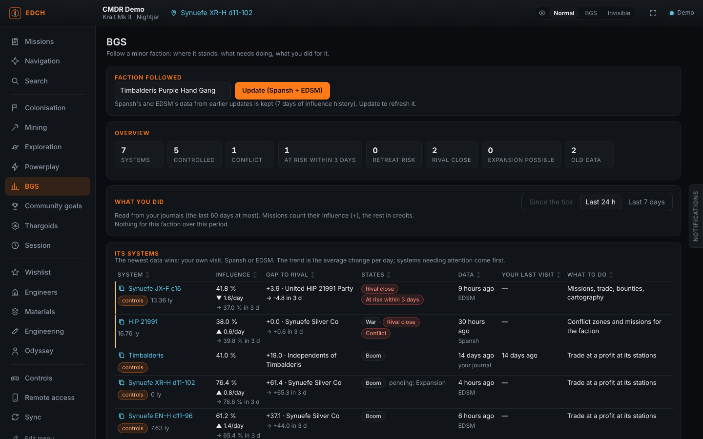
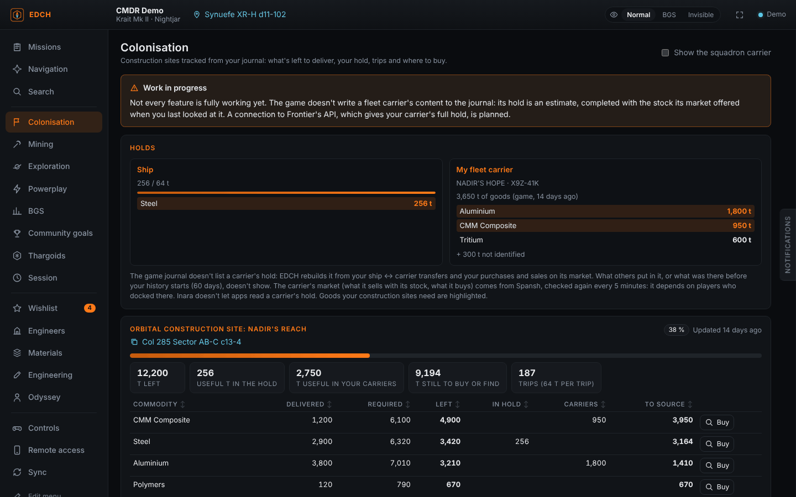
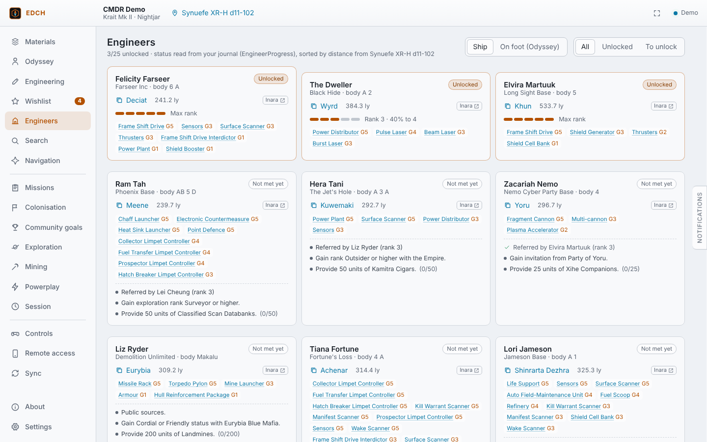

# EDCH — Elite Dangerous Companion Helper

[English](README.md) · [Français](README.fr.md) · **Deutsch** · [Español](README.es.md) · [Português (Brasil)](README.pt-BR.md) · [Русский](README.ru.md) · [Code signing policy (Signaturrichtlinie)](CODE_SIGNING_POLICY.md)

Ein schlanker Begleiter für **Elite Dangerous** (Windows und Linux, x64 und ARM). Er liest das Spiel-Journal in Echtzeit und zeigt dir für jedes Ingenieursmaterial, **wo du es findest – mit echten, anklickbaren Systemen in deiner Nähe**.

## ⚠️ Bitte zuerst lesen

**EDCH ist kein Ersatz für die anderen Tools der Community.** Es ist ein unabhängiges Projekt ohne Verbindung zu [EDMarketConnector](https://github.com/EDCD/EDMarketConnector), [Odyssey Materials Helper](https://github.com/jixxed/ed-odyssey-materials-helper), [EDEngineer](https://github.com/msarilar/EDEngineer), Inara, Spansh oder anderen Projekten und nicht mit Frontier Developments verbunden. Wenn dir eines dieser Tools gefällt, nutze es weiter: Sie sind älter, vollständiger und von Tausenden Spielern erprobt.

**EDCH wurde größtenteils von einer KI (Claude von Anthropic) geschrieben, begleitet von einem Entwickler**, der die Funktionen festlegt und jede Version testet und freigibt. Das Tool kann daher unvollständig sein, Fehler oder ungenaue Daten enthalten. Wenn du welche findest, eröffne bitte ein [Issue](../../issues).

**Ohne die Arbeit anderer würde EDCH nicht funktionieren.** Daten, Übersetzungen und Suchen stammen aus Projekten, die ehrenamtlich von Mitgliedern der Community aufgebaut und gepflegt werden: Spansh, EDDN und EDCD, EDSM, Inara, EDEngineer, Odyssey Materials Helper, Elite Dangerous Almanac, EDRefCard, EDAssets, EDSY, Coriolis… Wenn dir EDCH nützt, bedanke dich bei ihnen, unterstütze sie oder trage zu ihren Projekten bei. Details unter [Danksagungen](#danksagungen) und in [NOTICE](NOTICE).



## Was es kann

- **Live-Inventar**: Roh-, hergestellte und kodierte Materialien, angeordnet wie beim Materialhändler (eine Zeile pro Familie, Stufen 1 bis 5) mit Füllstandsanzeige. Der Odyssey-Schiffsspind (Daten, Komponenten, Gegenstände, Verbrauchsgüter) wird aus `ShipLocker.json` gelesen.
- **Fundorte mit echten Systemen**: Jede Spawn-Bedingung wird zu einer [Spansh](https://spansh.co.uk)-Suche rund um deine Position.
  - HGE: bevölkerte Systeme im Boom/in Expansion, Krieg, Unruhen, Ausbruch, Föderation oder Imperium. Zu alte Fraktionszustände werden ignoriert.
  - Kodierte Emissionen nach Sicherheitsstufe, Konfliktzonen, Hochenergie-Spuren.
  - Landbare Planeten nach Rohmaterial-% sortiert, Eisringe oder unberührte Ringe, Guardian- und Thargoiden-Stätten.
  - Odyssey-Siedlungen und bekannte Farmstellen (Jameson, Dav's Hope, Brain Trees, Kristalle…).
  - Klick auf ein System: Es wird kopiert und kann direkt in die Galaxiekarte eingefügt werden. Daneben Links zu Spansh und Inara.
- **Nächster Materialhändler** des passenden Typs, mit **Tauschvorschlägen** auf Basis deines Bestands (Kurse des Spiels, unter Berücksichtigung dessen, was deine Wunschliste reserviert).
- **Ingenieurwesen**: alle Modifikationen, experimentellen Effekte, Synthesen, Technologiemakler-Freischaltungen und Odyssey-Upgrades, mit dem, was du schon besitzt.
- **Wunschliste**: Füge Modifikationen hinzu (Stufen, Anzahl der Würfe, Menge). Sie berechnet, was fehlt, und den besten Tausch, um es zu decken. Jede Zeile zeigt den nächsten bekannten Ingenieur, der sie machen kann. Zeilen, die dein Schiff schon hat, gelten als erledigt, und die Zeilen schreiten von selbst fort, wenn das Spiel eine Modifikation anwendet. Ein Schalter **Einfach / Erweitert**: Erweitert zeigt jede Zeile und die nötigen Materialien; Einfach zeigt nur die **Ingenieurs-Tour**, die zu besuchenden Ingenieure (der nächste zuerst) mit den an jedem Halt noch fehlenden Materialien. Klicke auf einen Ingenieur, und sein System wird für die Galaxiekarte kopiert; ist das Engineering dort erledigt, wird das nächste System von selbst kopiert. **Mein Schiff nach EDSY exportieren** (oder Coriolis) öffnet dein aktuelles Schiff auf der Build-Seite.
- **Ingenieure**: Status und Rang aus dem Journal, kopierbares System, Entfernung, und Freischaltbedingungen, die automatisch abgehakt werden, wenn das Journal sie prüfen kann (Odyssey-Spind, Fracht, Materialien). Das Spiel ergänzt die Daten von EDCH: Jedes Engineering im Journal (wer welche Modifikation in welcher Stufe gemacht hat) wird gemerkt.
- **Build-Import**: Füge einen **EDSY**- oder **Coriolis**-Export ein oder wähle die Datei (SLEF oder Loadout-JSON). Jedes modifizierte Modul und sein experimenteller Effekt landen auf der Wunschliste. Du kannst auch von deinem aktuellen Schiff ausgehen.
- **Suche wie bei Inara**: wo du eine Ware kaufen oder verkaufen kannst (nach Preis oder Entfernung), ein Schiff, ein Modul (Klasse und Bewertung) oder einen Dienst (Interstellar Factors, Technologiemakler, Materialhändler…) in deiner Nähe. Ein Tab **Fraktion** findet die Systeme, in denen eine Minor Faction vertreten ist oder herrscht, nach Fraktionszustand. Jede Station zeigt ihren Typ als Symbol (Coriolis, Orbis, Außenposten, Carrier, Planetenhafen…).
- **Navigation**: Sprungreichweite deines Schiffs (leer, voll, beladen, jetzt, simulierte Fracht), Route mit Neutronen-Boost über Spansh und Fleet Carrier (Sprünge, Tritium und Dauer – als Schnellschätzung oder detaillierter Spansh-Plan mit Nachladestopps).
- **Steuerung & Geräte**: liest deine Tastenbelegung (aktive Vorlage, auch unterschiedliche Vorlagen für Schiff, SRV und zu Fuß) und zeichnet jedes Gerät. Die Tastatur wird Taste für Taste gezeichnet (QWERTY, AZERTY oder QWERTZ), das Xbox- oder PlayStation-Gamepad mit nummerierten Markierungen. Erkannte HOTAS, Joysticks und Gamepads (etwa 60 Modelle: VKB, Virpil, Thrustmaster, Saitek/Logitech, CH…) werden auf dem Bild des Modells gezeigt, mit der Aktion im Feld jeder Taste. Die Vorlagen stammen von EDRefCard und werden aus dessen GitHub-Repository geladen. Für ein unbekanntes Modell wählst du die ähnlichste Vorlage, sonst erscheint ein einfaches Schema mit Achsen, Coolie-Hats und Tasten. Jeder Befehl hat eine Legende und eine Farbe pro Modus, mit Filtern Schiff / SRV / Zu Fuß, Suche und druckbarem Blatt. Wähle deine Tastatur (AZERTY, QWERTY oder QWERTZ) und ihr Format (ISO oder ANSI). **Konfigurieren** legt eine Kopie deiner Vorlagen namens `…_EDCH` an (die des Spiels werden nie geändert) und lässt dich eine Belegung ändern, indem du sie auf der Zeichnung anklickst oder auf deinem Gerät betätigst; drücke eine beliebige Taste oder einen Knopf, und die Seite zeigt, was er tut. Auch die Standardvorlagen des Spiels werden angezeigt.
- **Sicherung der Konfiguration**: exportiert deine Tastenbelegung (und Grafikeinstellungen) als Zip nach Dokumente\EDCH und stellt sie mit einem Klick wieder her. Vor jedem Import wird die aktuelle Konfiguration automatisch gesichert.
- **Missionen**: jede laufende Mission mit Ziel, Zielort, verbleibender Zeit und Fortschritt; gestapelte Massakermissionen mit den Abschüssen, die jede Auftraggeber-Fraktion noch braucht.
- Bei Beschaffungs- und Bergbaumissionen, wo man die Ware bekommt: Stationen nach Preis, Entfernung und Aktualität der Marktdaten sortiert, mit geschätztem Gewinn, und die nächsten Hotspots für Bergbaumissionen.
- **Geteilte Geschwadermissionen**: Geschwadermitglieder mit EDCH geben denselben Code ein und sehen, wer welche geteilte Mission angenommen hat: Du wählst, welche Missionen du teilst (oder alle automatisch). Die Nachrichten laufen über ntfy.sh, Ende-zu-Ende mit diesem Code verschlüsselt. Ein Ton und/oder eine blinkende Seitenlasche (keine Windows-Pop-ups) melden, wenn jemand eine Mission hat, die du nicht hast, oder wenn das ganze Geschwader sie angenommen hat.
- **Kolonisierung**: jedes Baudepot mit dem, was noch zu liefern ist, was in deinem Frachtraum ist, den nötigen Fahrten und einer Suche per Klick, wo man jede Ware kauft.
- **Community-Ziele**: dein Beitrag, deine Belohnungsstufe und die erreichte Stufe der Ziele, denen du beigetreten bist; alle laufenden Ziele über Inara mit deinem API-Schlüssel.
- **Erkundung**: Wert der nicht verkauften Kartendaten, Hilfe bei Exobiologie-Proben (Abstand zu den vorherigen Proben im Vergleich zur Kolonie-Reichweite), mögliche Arten und Werte für jeden Planeten mit biologischen Signalen, nicht verkaufte Analysen.
- **Bergbau**: Prospektor-Ergebnisse live mit Hinweisen für deine Ziele und Kerne, Tonnage der Sitzung; eine Suche im Stil von Merit Miner, wo man in den Systemen deiner Macht abbaut und verkauft.
- **Powerplay und Sitzung**: Verdienste der Woche und der Sitzung, Powerplay-Zustand des aktuellen Systems; verdiente Credits nach Aktivität seit der Anmeldung. Ein Knopf **Zähler zurücksetzen** startet die Zähler für Sitzung, Bergbau oder Powerplay neu.
- **Thargoiden**: die Thargoiden, die du abgeschossen hast, nach Schiffstyp (Späher, Cyclops, Basilisk, Medusa, Hydra…), in dieser Sitzung und in den letzten 60 Tagen Journal, mit ihren Anleihen, und die AX-Konfliktzonen, die du betreten hast.
- **BGS**: Verfolge eine Minor Faction. Ihre Systeme mit Einfluss, Abstand zur nächsten Rivalin, Zuständen und Warnungen (Konflikt, Rückzugsgefahr, Rivalin nah, Expansion möglich, alte Daten), was in jedem System zu tun ist, und der **Trend**: die durchschnittliche Einflussänderung pro Tag und der in 3 Tagen erwartete Einfluss, mit einer Warnung „Gefährdet in 3 Tagen“. Was du seit dem BGS-Tick, in 24 Stunden oder 7 Tagen für sie getan hast (Missionen und ihr Einfluss, Kopfgelder, Kampfanleihen, Handel, Kartografie und was gegen sie zählte), und eine Aktualisierungsrunde durch die Systeme mit alten Daten. Dein Journal wird zuerst gelesen; „Aktualisieren“ lädt die Systeme der Fraktion von Spansh und ihren Einflussverlauf von EDSM (7 Tage aufbewahrt).
- **Fernzugriff**: Öffne EDCH auf Handy oder Tablet per QR-Code. Ein lokaler Server (standardmäßig aus) stellt die App in deinem Netzwerk bereit. Nur Geräte, die den QR-Code gescannt haben, erhalten Zugang – die IP des PCs allein reicht nicht. „Neuer Code“ trennt alle Geräte. Die Oberfläche passt sich dem Handy an (Navigation unten, Vollbild-Panels), und Änderungen an der Wunschliste auf dem Handy werden zum PC synchronisiert. Öffnet auf Wunsch auch eine einzelne Seite im Browser, für einen zweiten Bildschirm, und ein Vollbildmodus zeigt nur die aktuelle Seite.
- **Themes**: fertige Themes (darunter ein helles „Tag“-Theme), eigene Farben und ein OLED-Modus. Zu helle oder zu dunkle Farben werden automatisch lesbar gemacht.
- **Oberfläche**: Das Menü ist nach Nutzung im Spiel gruppiert und lässt sich neu ordnen (Seiten ziehen, ausblenden, wählen, welche das Handy zeigt). **Jede Tabelle ist sortierbar**: Klicke auf einen Spaltentitel, erneut für die umgekehrte Reihenfolge, ein drittes Mal für die übliche.
- **Automatische Updates**: EDCH prüft auf GitHub, ob es eine neue Version gibt, zeigt ein Banner, lädt das Installationsprogramm auf Wunsch herunter (Prüfsumme kontrolliert) und startet sich zum Abschluss neu. In den Einstellungen abschaltbar.
- **Synchronisierung wie EDMC**: Live-Übertragung an **EDDN** (Märkte, Ausrüstung, Werften, Sprünge, Scans, Routen), **EDSM** und **Inara** (mit deinem API-Schlüssel). Die Regeln von EDDN werden eingehalten: persönliche Daten entfernt, Position gegengeprüft, abgelehnte Nachrichten werden nie erneut gesendet, nichts aus deinem Verlauf. Ein Schalter für den **Teilen-Modus** in der oberen Leiste: **Normal**, **BGS** (Fraktionen, Einfluss, Zustände und Konflikte, deine Missionen und ihre Belohnungen bleiben privat: nichts davon geht an EDDN, EDSM oder Inara) oder **Unsichtbar** (es wird gar nichts gesendet).



<p>


</p>
<p>


</p>
<p>

</p>

## Daten und Privatsphäre

EDCH liest das Spiel-Journal auf deinem PC. Das ist alles, was ihn verlässt, und wohin:

- **Spansh**: deine Suchen (System, Material, Ware, Minor Faction…) und deine Position als Ausgangspunkt.
- **EDDN** (standardmäßig an, wie bei EDMC; unter Synchronisierung abschaltbar): Markt-, Ausrüstungs-, Werft-, Sprung- und Scandaten, ohne persönliche Daten, wie EDDN es verlangt.
- **EDSM und Inara**: nichts über dich, solange du nicht unter Synchronisierung deinen eigenen API-Schlüssel einträgst; deine Schlüssel bleiben auf deinem PC. EDCH liest außerdem öffentliche Daten von EDSM, wenn du darum bittest (die Himmelskörper eines Systems auf der Seite Erkundung, den Einflussverlauf einer Fraktion auf der BGS-Seite): Nur der Name des Systems wird gesendet.
- **Der Discord-Bot EDCH** (auf dem Server deines Geschwaders): nichts, solange du deinen Schlüssel nicht unter Synchronisierung einfügst und den Schalter einschaltest. Dann alle 15 Minuten, was du für die Fraktion des Geschwaders getan hast (Systeme, Missionen und ihr Einfluss, Credits; kein Kommandantenname), geschrieben in einen privaten Kanal des Discord-Servers deines Geschwaders.
- **ntfy.sh** (nur wenn du das Geschwader-Teilen aktivierst): deine Geschwadermissionen, mit dem Geschwadercode verschlüsselt, bevor sie deinen PC verlassen.
- **tick.edcd.io** (nur solange die BGS-Seite mit einer verfolgten Fraktion angezeigt wird): fragt die Zeit des letzten BGS-Ticks ab. Dabei wird nichts gesendet.
- **GitHub**: nur um zu prüfen, ob es eine neue Version gibt (in den Einstellungen abschaltbar).
- **Fernzugriff**: bleibt in deinem lokalen Netzwerk; standardmäßig aus und durch den QR-Code geschützt.

Sonst wird nichts gesammelt oder gesendet. Einstellungen, Schlüssel, Wunschliste und der Verlauf der BGS-Seite (7 Tage) liegen in `%LOCALAPPDATA%\EDCompanionHelper`.

**Die Dateien des Spiels**: EDCH liest das Journal und die Dateien, die das Spiel daneben schreibt (`Status.json`, `Cargo.json`, `Market.json`…), sowie deine Steuerungsdateien (`Options\Bindings`), um sie anzuzeigen, zu exportieren und zu importieren; eine Steuerungsdatei schreibt es nur für seine eigenen Voreinstellungen (`…_EDCH` genannt), nie für die des Spiels. Im Installationsordner des Spiels sind die **einzigen** Dateien, die EDCH berührt, die Standard-Steuerungsvoreinstellungen (`ControlSchemes\*.binds`), **nur lesend**, um sie auf der Seite Steuerung anzuzeigen und zu kopieren. Sonst wird nichts vom Spiel gelesen oder verändert.

## Sprachen

EDCH gibt es in den sechs Sprachen des Spiels: Englisch (Standard), Französisch, Deutsch, Spanisch, Portugiesisch (Brasilien) und Russisch. Das Installationsprogramm fragt nach der Sprache, und die App übernimmt sie beim ersten Start. Du kannst sie jederzeit unter **Einstellungen → Sprache** ändern. Namen von Materialien, Modulen, Bauplänen und Effekten folgen der Übersetzung des Spiels; Befehlsnamen bleiben wie im englischen Spiel.

Um eine Übersetzung hinzuzufügen oder zu korrigieren, bearbeite `public/locales/<Sprache>.json` (Englisch ist die Referenz); siehe [docs/TRANSLATING.md](docs/TRANSLATING.md). `npm run i18n:check` listet fehlende Texte auf.

## Installation

Lade das Installationsprogramm (`.exe` oder `.msi`) unter [Releases](../../releases) herunter oder die portable Version `EDCH_<version>_x64-portable.exe`: keine Installation, aus jedem Ordner startbar (sie meldet neue Versionen und öffnet die Release-Seite). Windows 10/11 bringt WebView2 bereits mit. Windows auf ARM hat ein eigenes Installationsprogramm und eine portable exe (`arm64`); Linux auf ARM eigene `.AppImage`, `.deb` und `.rpm` (`aarch64`). Das automatische Update wählt den Build deines Prozessors.

**Linux** (Steam/Proton, inklusive Steam Deck): Jedes Release enthält außerdem ein `.AppImage` (jede Distribution: ausführbar machen und starten), ein `.deb` (Debian, Ubuntu, Mint, Pop!_OS), ein `.rpm` (Fedora, openSUSE), ein `PKGBUILD` für Arch Linux und Derivate (`makepkg -si` im Ordner, in dem du es gespeichert hast) und ein experimentelles `.flatpak` (`flatpak install EDCH_….flatpak`). EDCH findet das Journal im Proton-Ordner von Steam selbst. Unter Linux werden Updates nicht automatisch installiert: EDCH öffnet die Release-Seite.

EDCH protokolliert, was es tut (Einstellungen → Anwendungsprotokolle, mit einer Schaltfläche zum Öffnen des Ordners). Ein Debug-Modus schreibt ein separates, ausführliches Protokoll für Fehlerberichte.

Das Installationsprogramm ist nicht digital signiert (ein Zertifikat ist für ein kostenloses Tool teuer), daher kann Windows SmartScreen beim ersten Mal „Der Computer wurde durch Windows geschützt“ anzeigen. Klicke auf **Weitere Informationen** und dann auf **Trotzdem ausführen**. Spätere Updates bietet EDCH selbst an.

Beim ersten Start wird der Journal-Ordner automatisch erkannt (`%USERPROFILE%\Saved Games\Frontier Developments\Elite Dangerous`). Du kannst ihn in den **Einstellungen** ändern.

## Entwicklung

Voraussetzungen: Node 20+, stabiles Rust und die [Tauri-Voraussetzungen](https://tauri.app/start/prerequisites/) für dein System.

```bash
npm install
npm test            # baut die Oberfläche und führt die Tests aus (Journal, Tausch, Spansh-Abfragen, EDDN, Belegung)
npm run app:dev     # startet die App
npm run app:build   # Windows-Installationsprogramme in src-tauri/target/release/bundle
npm run demo        # nur die Oberfläche im Browser, mit einem Beispiel-Journal
```

Aufbau:

- `src/`: TypeScript-Oberfläche ohne Framework, in Schichten (platform, game, state, ui, services, features, views, app); `src-tauri/`: Rust-Backend (Journal, HTTP, Optionsdateien, Fernzugriffs-Server, Updates), ohne Spiellogik. Siehe [docs/ARCHITECTURE.md](docs/ARCHITECTURE.md) und [CONTRIBUTING.md](CONTRIBUTING.md) (auf Englisch).
- `tools/gen_data.py`, `tools/gen_binds.py`, `tools/gen_game_locales.py`: erzeugen die Daten in `public/` neu (siehe NOTICE).

Jeder Push auf `main` oder auf einen Branch `prerelease/<version>` baut alle Plattformen; ein Push auf `prerelease/<version>` veröffentlicht außerdem eine Vorabversion (angeboten, wenn „Auch Vorabversionen anbieten“ angehakt ist). Um eine Version zu veröffentlichen, pushe einen Tag wie `v0.10.13`: Das Release wird veröffentlicht und installierte Kopien bieten das Update an.

## Roadmap

- Frontier-Anmeldung (cAPI, OAuth) für Flotte, Bestand und Fleet Carrier: Dafür ist eine Frontier-Client-ID nötig.
- EDDN: restliche Schemas (codexentry, approachsettlement, fssbodysignals, fsssignaldiscovered…).
- Optimierte Farmroute für die Wunschliste.
- BGS: die BGS-Arbeit über einen Bot mit deinem Geschwader teilen (zum Einschalten, standardmäßig aus).

## EDCH unterstützen

EDCH ist kostenlos, werbefrei und bleibt es auch. Es wird von CMDR MDLuffy entworfen, getestet und gepflegt und mit Hilfe der KI Claude (Anthropic) entwickelt. Wenn es dir hilft, kannst du das Projekt auf [Ko-fi](https://ko-fi.com/bknadir) unterstützen: Das bezahlt die Werkzeuge (das KI-Abo), die Zeit für Tests und Korrekturen und auf Dauer die Signatur der Anwendung.

## Danksagungen

Daten: EDCD/FDevIDs und msarilar/EDEngineer (MIT), über dseelinger/d47 (MIT). Übersetzte Spielnamen: Elite Dangerous Almanac (MIT) und EDEngineer. Befehlsnamen und Gerätevorlagen: EDRefCard (Richard Buckle, Jason Bramley — edrefcard2, MIT). Stationssymbole und Ladeanimation: EDAssets (SpyTec, MIT). Suchen: Spansh (EDDN). Einflussverlauf der Minor Factions: EDSM. BGS-Tick: der Tick-Detektor von EDCD. Die BGS-Seite ging vom Prototyp von Cyberpunk Philou aus. Elite Dangerous ist eine Marke von Frontier Developments plc. Inoffizielles, nicht kommerzielles Community-Tool. Details in [NOTICE](NOTICE).
