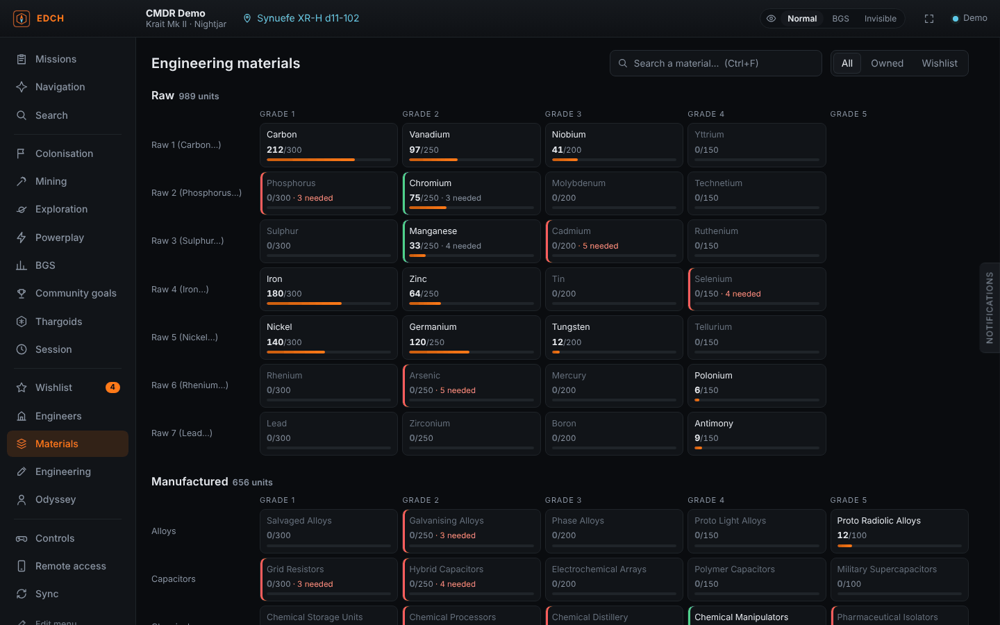
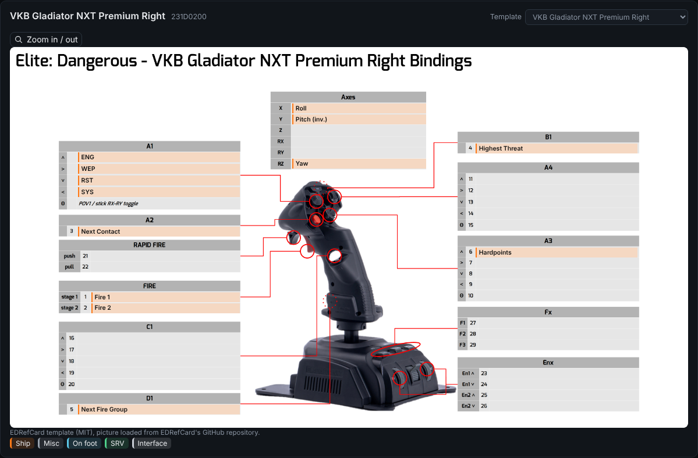
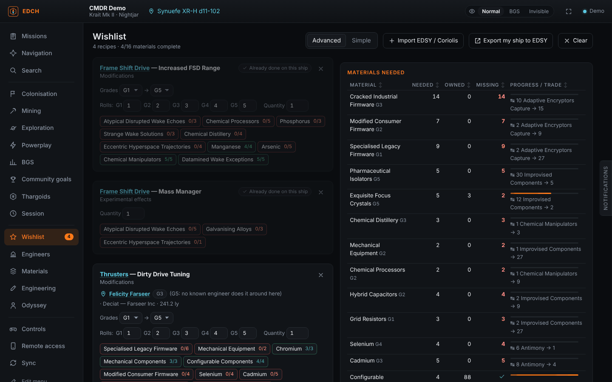
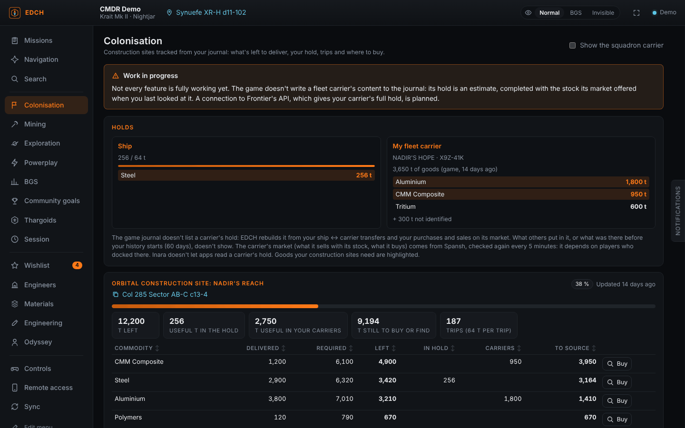
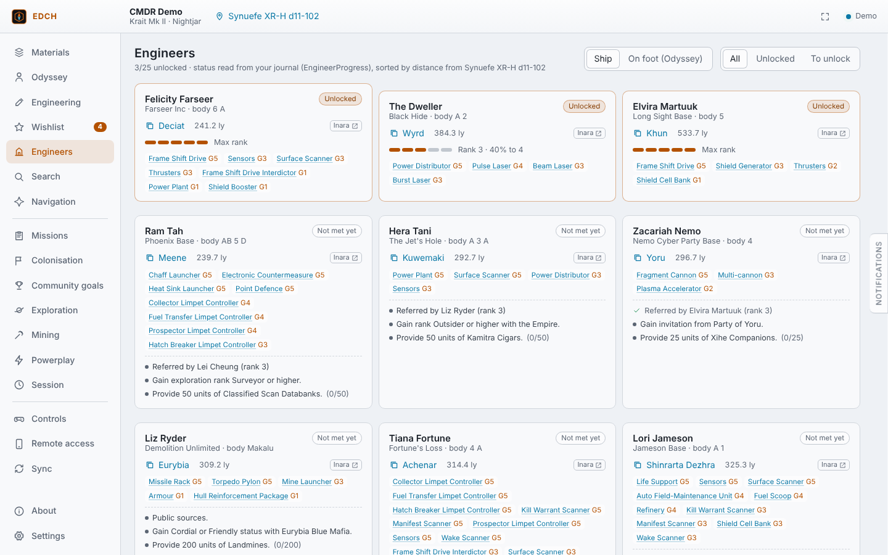
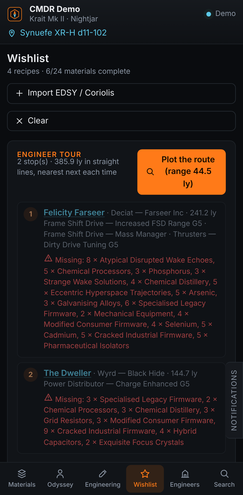

# EDCH — Elite Dangerous Companion Helper

[English](README.md) · [Français](README.fr.md) · [Deutsch](README.de.md) · **Español** · [Português (Brasil)](README.pt-BR.md) · [Русский](README.ru.md) · [Code signing policy (política de firma)](CODE_SIGNING_POLICY.md)

Un compañero ligero para **Elite Dangerous** (Windows). Lee el diario del juego en tiempo real y, para cada material de ingeniería, te dice **dónde encontrarlo, con sistemas reales y clicables a tu alrededor**.

## ⚠️ Léelo antes de usar EDCH

**EDCH no sustituye a las demás herramientas de la comunidad.** Es un proyecto independiente, sin relación con [EDMarketConnector](https://github.com/EDCD/EDMarketConnector), [Odyssey Materials Helper](https://github.com/jixxed/ed-odyssey-materials-helper), [EDEngineer](https://github.com/msarilar/EDEngineer), Inara, Spansh ni ningún otro proyecto, y no está afiliado a Frontier Developments. Si alguna de esas herramientas te sirve, sigue usándola: son más antiguas, más completas y probadas por miles de jugadores.

**EDCH ha sido escrito en gran parte por una IA (Claude, de Anthropic), con la supervisión de un desarrollador** que define las funciones y prueba y aprueba cada versión. Por eso la herramienta puede estar incompleta o contener errores o datos inexactos. Si encuentras alguno, abre una [issue](../../issues).

**EDCH no funcionaría sin el trabajo de otros.** Los datos, las traducciones y las búsquedas vienen de proyectos creados y mantenidos de forma voluntaria por miembros de la comunidad: Spansh, EDDN y EDCD, EDSM, Inara, EDEngineer, Odyssey Materials Helper, Elite Dangerous Almanac, EDRefCard, EDAssets, EDSY, Coriolis… Si EDCH te resulta útil, dales las gracias, apóyalos o contribuye a sus proyectos. Más detalles en [Créditos](#créditos) y en [NOTICE](NOTICE).



## Qué hace

- **Inventario en directo**: materiales brutos, fabricados y codificados, ordenados como en el comerciante de materiales (una fila por familia, grados 1 a 5) con indicador de almacenamiento. La taquilla de la nave de Odyssey (datos, componentes, objetos, consumibles) se lee desde `ShipLocker.json`.
- **Dónde encontrarlo, con sistemas reales**: cada condición de aparición se convierte en una búsqueda de [Spansh](https://spansh.co.uk) alrededor de tu posición.
  - HGE: sistemas poblados en Auge/Expansión, Guerra, Disturbios civiles, Epidemia, de la Federación o del Imperio. Se ignoran los estados de facción demasiado antiguos.
  - Emisiones codificadas según la seguridad, zonas de conflicto, estelas de alta energía.
  - Planetas aterrizables ordenados por % del material bruto, anillos helados o vírgenes, sitios guardianes y thargoid.
  - Asentamientos de Odyssey y lugares de farmeo conocidos (Jameson, Dav's Hope, brain trees, cristales…).
  - Clic en un sistema: se copia, listo para pegar en el mapa galáctico. Al lado, enlaces a Spansh e Inara.
- **Comerciante de materiales más cercano** del tipo adecuado, con **sugerencias de intercambio** calculadas sobre tu inventario (tasas del juego, teniendo en cuenta lo que reserva tu lista de deseos).
- **Ingeniería**: todas las modificaciones, efectos experimentales, síntesis, desbloqueos del intermediario tecnológico y mejoras de Odyssey, con lo que ya tienes.
- **Lista de deseos**: añade modificaciones (grados, número de tiradas, cantidad). Calcula lo que falta y el mejor intercambio para cubrirlo. Cada línea muestra el ingeniero conocido más cercano que puede hacerla, y una **ruta de ingenieros** encadena las paradas con una ruta de Spansh, los materiales que aún faltan en cada parada y, si quieres, el siguiente salto copiado nada más llegar. Las líneas avanzan solas cuando el juego aplica una modificación.
- **Ingenieros**: estado y rango leídos del diario, sistema copiable, distancia y condiciones de desbloqueo marcadas automáticamente cuando el diario permite comprobarlas (taquilla de Odyssey, bodega, materiales).
- **Importación de builds**: pega o elige una exportación de **EDSY** o **Coriolis** (SLEF o Loadout JSON). Cada módulo modificado y su efecto experimental van a la lista de deseos. También puedes partir de tu nave actual.
- **Búsqueda al estilo Inara**: dónde comprar o vender una mercancía (por precio o distancia), una nave, un módulo (clase y categoría) o un servicio (Interstellar Factors, intermediario tecnológico, comerciante de materiales…) a tu alrededor.
- **Navegación**: alcance de salto de tu nave (vacía, llena, cargada, ahora, carga simulada), ruta con impulso de estrellas de neutrones vía Spansh y Fleet Carrier (saltos, tritio y duración, como estimación rápida o plan detallado de Spansh con paradas de reabastecimiento).
- **Controles y dispositivos**: lee tus asignaciones (preajuste activo, incluidos preajustes distintos para nave, SRV y a pie) y dibuja cada dispositivo. El teclado se dibuja tecla a tecla (QWERTY, AZERTY o QWERTZ) y el mando de Xbox o PlayStation con marcadores numerados. Los HOTAS, joysticks y mandos reconocidos (unos 60 modelos: VKB, Virpil, Thrustmaster, Saitek/Logitech, CH…) se muestran sobre la imagen del modelo, con la acción escrita en la casilla de cada botón. Las plantillas vienen de EDRefCard y se cargan desde su repositorio de GitHub. Para un modelo no reconocido eliges la plantilla más parecida; si no, se muestra un esquema simple de ejes, setas y botones. Cada control tiene su leyenda y un color por modo, con filtros Nave / SRV / A pie, búsqueda y ficha imprimible. Elige tu teclado (AZERTY, QWERTY o QWERTZ) y su formato (ISO o ANSI).
- **Copia de seguridad de la configuración**: exporta tus asignaciones (y ajustes gráficos) a un zip en Documentos\EDCH y las restaura con un clic. Tu configuración actual se guarda automáticamente antes de cada importación.
- **Misiones**: cada misión en curso con su objetivo, destino, tiempo restante y progreso; las misiones de masacre apiladas con las bajas que aún necesita cada facción emisora.
- En las misiones de abastecimiento y minería, dónde conseguir la mercancía: estaciones ordenadas por precio, distancia y antigüedad de los datos del mercado, con el beneficio estimado, y los puntos calientes más cercanos para las misiones de minería.
- **Misiones de ala compartidas**: los miembros del ala que usan EDCH introducen el mismo código y ven quién aceptó cada misión compartida: eliges qué misiones compartir (o todas automáticamente). Los mensajes pasan por ntfy.sh, cifrados de extremo a extremo con ese código. Un sonido y/o una pestaña lateral que parpadea (sin ventanas de Windows) te avisan cuando alguien tiene una misión que tú no tienes, o cuando toda el ala la ha aceptado.
- **Colonización**: cada depósito de construcción con lo que falta entregar, lo que llevas en la bodega, los viajes necesarios y una búsqueda con un clic de dónde comprar cada mercancía.
- **Objetivos comunitarios**: tu contribución, tu tramo de recompensa y el nivel de los objetivos a los que te uniste; todos los objetivos en curso a través de Inara con tu clave API.
- **Exploración**: valor de los datos cartográficos no vendidos, ayuda con las muestras de exobiología (distancia a las muestras anteriores frente al alcance de la colonia), especies posibles y valores de cada planeta con señales biológicas, análisis no vendidos.
- **Minería**: resultados de los prospectores en directo con alertas para tus objetivos y núcleos, tonelaje de la sesión; una búsqueda al estilo Merit Miner de dónde minar y vender en los sistemas de tu potencia.
- **Powerplay y sesión**: méritos de la semana y de la sesión, estado de Powerplay del sistema actual; créditos ganados por actividad desde que te conectaste.
- **Acceso remoto**: abre EDCH en tu móvil o tableta escaneando un código QR. Un servidor local (desactivado por defecto) sirve la aplicación en tu red. Solo entran los dispositivos que escanearon el código QR: la IP del PC no basta. «Código nuevo» desconecta todos los dispositivos. La interfaz se adapta al móvil (navegación abajo, paneles a pantalla completa) y los cambios en la lista de deseos hechos en el móvil vuelven al PC. También puede abrir una página sola en un navegador, para una segunda pantalla, y un modo de pantalla completa muestra solo la página actual.
- **Temas**: temas listos (incluido un tema claro «Día»), colores propios y modo OLED. Los colores demasiado claros u oscuros para leerse se ajustan automáticamente.
- **Actualizaciones automáticas**: EDCH comprueba en GitHub si hay una versión nueva, muestra un aviso, descarga el instalador cuando lo pides (suma de comprobación verificada) y se reinicia para terminar. Se puede desactivar en Ajustes.
- **Sincronización al estilo EDMC**: envío en directo a **EDDN** (mercados, equipamiento, astilleros, saltos, escaneos, rutas), **EDSM** e **Inara** (con tu clave API). Se respetan las reglas de EDDN: datos personales eliminados, posición verificada, un mensaje rechazado nunca se reenvía, nada de tu historial.



<p>


</p>
<p>


</p>

## Datos y privacidad

EDCH lee el diario del juego en tu PC. Esto es todo lo que sale de él, y hacia dónde:

- **Spansh**: tus búsquedas (sistema, material, mercancía…) y tu posición como punto de partida.
- **EDDN** (activado por defecto, como en EDMC; se puede desactivar en Sincronización): datos de mercados, equipamiento, astilleros, saltos y escaneos, sin tus datos personales, como exige EDDN.
- **EDSM e Inara**: nada mientras no introduzcas tu propia clave API en Sincronización. Tus claves se quedan en tu PC.
- **ntfy.sh** (solo si activas el ala compartida): tus misiones de ala, cifradas con el código del ala antes de salir de tu PC.
- **GitHub**: solo para comprobar si hay una versión nueva (se puede desactivar en Ajustes).
- **Acceso remoto**: se queda en tu red local; desactivado por defecto y protegido por el código QR.

No se recoge ni se envía nada más. Tus ajustes, claves y lista de deseos se guardan en `%LOCALAPPDATA%\EDCompanionHelper`.

**Los archivos del juego**: EDCH lee el diario y los archivos que el juego escribe a su lado (`Status.json`, `Cargo.json`, `Market.json`…), y tus archivos de controles (`Options\Bindings`) para mostrarlos, exportarlos e importarlos; solo escribe un archivo de controles para sus propios preajustes (llamados `…_EDCH`), nunca los del juego. En la carpeta de instalación del juego, los **únicos** archivos que EDCH toca son los preajustes de controles por defecto (`ControlSchemes\*.binds`), **en solo lectura**, para mostrarlos en la página Controles y copiarlos. No se lee ni se modifica nada más del juego.

## Idiomas

EDCH está disponible en los seis idiomas del juego: inglés (predeterminado), francés, alemán, español, portugués (Brasil) y ruso. El instalador pregunta el idioma y la aplicación lo usa en el primer inicio. Puedes cambiarlo cuando quieras en **Ajustes → Idioma**. Los nombres de materiales, módulos, planos y efectos siguen la traducción del juego; los nombres de los controles se mantienen como en el juego en inglés.

Para añadir o corregir una traducción, edita `public/locales/<idioma>.json` (el inglés es la referencia); consulta [docs/TRANSLATING.md](docs/TRANSLATING.md). `npm run i18n:check` lista los textos que faltan.

## Instalación

Descarga el instalador (`.exe` o `.msi`) desde [Releases](../../releases), o la versión portátil `EDCH_<version>_x64-portable.exe`: sin instalación, ejecútala desde cualquier carpeta (avisa cuando sale una nueva versión y abre la página de la release). Windows 10/11 ya incluye WebView2.

**Linux** (Steam/Proton, Steam Deck incluido): cada release incluye también un `.AppImage` (cualquier distribución: hazlo ejecutable y lánzalo), un `.deb` (Debian, Ubuntu, Mint, Pop!_OS), un `.rpm` (Fedora, openSUSE), un `PKGBUILD` para Arch Linux y derivadas (`makepkg -si` en la carpeta donde lo guardaste) y un `.flatpak` experimental (`flatpak install EDCH_….flatpak`). EDCH encuentra solo el diario en la carpeta Proton de Steam. En Linux, las actualizaciones no se instalan automáticamente: EDCH abre la página de la release.

EDCH guarda registros de lo que hace (Ajustes → Registros de la aplicación, con un botón para abrir la carpeta). Un modo debug escribe un registro detallado aparte, para adjuntarlo a un informe de error.

El instalador no está firmado digitalmente (un certificado es caro para una herramienta gratuita), así que Windows SmartScreen puede mostrar «Windows protegió su PC» la primera vez. Pulsa **Más información** y luego **Ejecutar de todas formas**. Las siguientes actualizaciones se ofrecen dentro de EDCH.

En el primer inicio, la carpeta del diario se detecta automáticamente (`%USERPROFILE%\Saved Games\Frontier Developments\Elite Dangerous`). Puedes cambiarla en **Ajustes**.

## Desarrollo

Requisitos: Node 20+, Rust estable y los [requisitos de Tauri](https://tauri.app/start/prerequisites/) para Windows.

```bash
npm install
npm test            # compila la interfaz y ejecuta las pruebas (diario, intercambios, consultas a Spansh, EDDN, asignaciones)
npm run app:dev     # inicia la aplicación
npm run app:build   # instaladores de Windows en src-tauri/target/release/bundle
npm run demo        # solo la interfaz en un navegador, con un diario de ejemplo
```

Estructura:

- `src/`: interfaz TypeScript sin framework, por capas (platform, game, state, ui, services, features, views, app); `src-tauri/`: backend en Rust (diario, HTTP, archivos de opciones, servidor de acceso remoto, actualizaciones), sin lógica de juego. Consulta [docs/ARCHITECTURE.md](docs/ARCHITECTURE.md) y [CONTRIBUTING.md](CONTRIBUTING.md) (en inglés).
- `tools/gen_data.py`, `tools/gen_binds.py`, `tools/gen_game_locales.py`: regeneran los datos de `public/` (ver NOTICE).

Con cada push a `main` se lanza una compilación para Windows. Para publicar una versión, sube una etiqueta como `v0.10.13`: se publica la Release y las copias instaladas ofrecen la actualización.

## Hoja de ruta

- Inicio de sesión de Frontier (cAPI, OAuth) para la flota, el inventario y el Fleet Carrier: hace falta un Client ID de Frontier.
- EDDN: esquemas restantes (codexentry, approachsettlement, fssbodysignals, fsssignaldiscovered…).
- Ruta de farmeo optimizada para la lista de deseos.

## Apoyar EDCH

EDCH es gratuito, sin publicidad, y seguirá así. Lo diseña, prueba y mantiene CMDR MDLuffy, y se desarrolla con la ayuda de la IA Claude (Anthropic). Si te resulta útil, puedes apoyar el proyecto en [Ko-fi](https://ko-fi.com/bknadir): eso paga las herramientas (la suscripción a la IA), el tiempo de pruebas y correcciones y, más adelante, la firma de la aplicación.

## Créditos

Datos: EDCD/FDevIDs y msarilar/EDEngineer (MIT), a través de dseelinger/d47 (MIT). Nombres del juego traducidos: Elite Dangerous Almanac (MIT) y EDEngineer. Nombres de controles y plantillas de dispositivos: EDRefCard (Richard Buckle, Jason Bramley — edrefcard2, MIT). Iconos de las estaciones y animación de carga: EDAssets (SpyTec, MIT). Búsquedas: Spansh (EDDN). Elite Dangerous es una marca de Frontier Developments plc. Herramienta comunitaria no oficial y sin fines comerciales. Detalles en [NOTICE](NOTICE).
