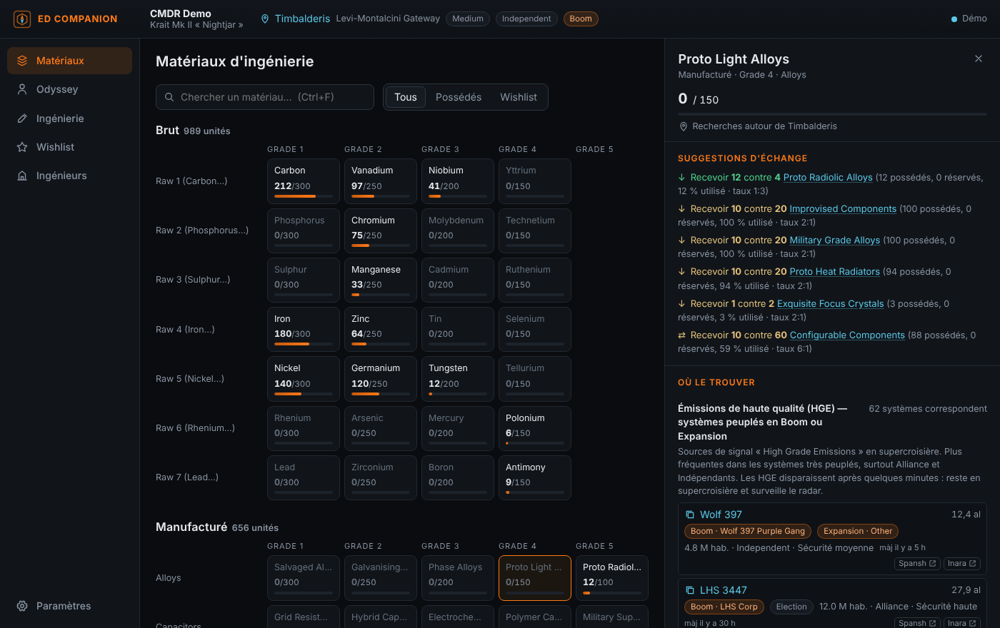

# EDCH — Elite Dangerous Companion Helper

Compagnon léger pour **Elite Dangerous** (Windows). Il lit le journal du jeu en temps réel et, pour chaque matériau d'ingénierie, te dit **où le trouver avec de vrais systèmes cliquables autour de toi**.



## Ce qu'il fait

- **Inventaire en direct** : matériaux bruts, manufacturés et encodés, rangés comme chez le trader (une ligne par famille, grades 1 à 5) avec la jauge de stockage. Le casier Odyssey (données, composants, objets, consommables) est lu depuis `ShipLocker.json`.
- **Où le trouver, avec des systèmes réels** : chaque condition de spawn devient une recherche [Spansh](https://spansh.co.uk) autour de ta position.
  - HGE : systèmes peuplés en Boom/Expansion, Guerre, Troubles civils, Épidémie, Fédération ou Empire. Les états de faction trop vieux sont ignorés.
  - Émissions encodées selon la sécurité, zones de conflit, sillages haute énergie.
  - Planètes atterrissables classées par % du matériau brut, anneaux glacés ou vierges, sites Gardiens et Thargoid.
  - Installations Odyssey et sites de farm connus (Jameson, Dav's Hope, brain trees, cristaux…).
  - Clic sur un système : il est copié, prêt à coller dans la carte galactique. Liens Spansh et Inara à côté.
- **Trader le plus proche** du bon type, avec des **suggestions d'échange** calculées sur ton stock (taux du jeu, en tenant compte de ce que ta wishlist réserve).
- **Ingénierie** : toutes les modifications, effets expérimentaux, synthèses, courtiers technologiques et améliorations Odyssey, avec ce que tu possèdes déjà.
- **Wishlist** : ajoute des modifications (grades, nombre de jets, quantité). Elle calcule ce qu'il manque et le meilleur échange pour le combler.
- **Ingénieurs** : statut et rang lus dans le journal, système copiable, distance, et conditions de déblocage cochées automatiquement quand le journal permet de les vérifier (casier Odyssey, soute, matériaux).
- **Import de build** : colle ou choisis un export **EDSY** ou **Coriolis** (SLEF ou Loadout JSON). Chaque module ingénié et son effet expérimental vont dans la wishlist. Tu peux aussi repartir de ton vaisseau actuel.
- **Recherche façon Inara** : où acheter ou vendre une marchandise (par prix ou par distance), un vaisseau, un module (classe et note) ou un service (Interstellar Factors, courtier, trader…) autour de toi.
- **Navigation** : portée de saut de ton vaisseau (vide, plein, chargé, maintenant, cargaison simulée), itinéraire avec boost neutron via Spansh, et Fleet Carrier (sauts, tritium et durée, en estimation rapide ou en plan Spansh détaillé avec ravitaillements).
- **Commandes & contrôleurs** : lit tes raccourcis (préréglage actif, y compris des préréglages différents pour vaisseau, SRV et à pied) et dessine chaque périphérique. Le clavier est dessiné touche par touche (AZERTY, QWERTY ou QWERTZ) et la manette Xbox ou PlayStation avec des repères numérotés. Les HOTAS et joysticks (VKB, Virpil, Thrustmaster…) sont présentés en axes, chapeaux et boutons. Chaque commande a sa légende et une couleur par mode, avec filtres Vaisseau, SRV ou À pied, une recherche et l'impression de la fiche.
- **Sauvegarde de la configuration** : exporte tes raccourcis (et tes réglages graphiques) en zip dans Documents\EDCH, et restaure-les en un clic. La configuration actuelle est sauvegardée automatiquement avant chaque import.
- **Synchro façon EDMC** : envoi en direct vers **EDDN** (marchés, équipements, chantiers, sauts, scans, routes), **EDSM** et **Inara** (avec ta clé API). Les règles d'EDDN sont respectées : données personnelles retirées, position recoupée, aucun renvoi d'un message refusé, rien de l'historique.

## Installer

Télécharge l'installateur (`.exe` ou `.msi`) dans les [Releases](../../releases), ou la version portable `edch.exe` dans les artefacts du dernier build (onglet *Actions*). Windows 10/11 a déjà WebView2.

Au premier lancement, le dossier du journal est détecté tout seul (`%USERPROFILE%\Saved Games\Frontier Developments\Elite Dangerous`). Tu peux le changer dans **Paramètres**.

## Développer

Prérequis : Node 20+, Rust stable, et les [prérequis Tauri](https://tauri.app/start/prerequisites/) pour Windows.

```bash
npm install
npm test            # compile l'interface et lance les tests (journal, échanges, requêtes Spansh)
npm run app:dev     # lance l'appli
npm run app:build   # installateurs Windows dans src-tauri/target/release/bundle
npm run demo        # interface seule dans un navigateur, avec un journal d'exemple
```

Structure :

- `src-tauri/` : backend Rust (lecture du journal, fichiers JSON du jeu, appels Spansh, ouverture de liens). Il ne contient aucune logique de jeu.
- `src/` : interface en TypeScript sans framework.
  - `journal.ts` : état du commandant à partir des événements.
  - `sources.ts` : conditions de spawn transformées en recherches.
  - `spansh.ts` : appels et mise en forme des résultats.
  - `trade.ts` : taux du trader.
- `tools/gen_data.py` : régénère `public/data/game.json` à partir des tables communautaires (voir NOTICE).

Un build Windows se lance à chaque push sur `main`. Pour publier une version, pousse un tag `v0.1.0` : un brouillon de Release est créé.

## Feuille de route

- Connexion Frontier (cAPI, OAuth) pour la flotte, le stock et le Fleet Carrier : il faut un Client ID Frontier.
- EDDN : schémas restants (codexentry, approachsettlement, fssbodysignals, fsssignaldiscovered…).
- Itinéraire de farm optimisé pour la wishlist.
- Interface en anglais.

## Crédits

Données : EDCD/FDevIDs et msarilar/EDEngineer (MIT), via dseelinger/d47 (MIT). Noms des commandes : EDRefCard (Richard Buckle, MIT). Recherches : Spansh (EDDN). Elite Dangerous est une marque de Frontier Developments plc. Outil communautaire non officiel et non commercial. Détails dans [NOTICE](NOTICE).
