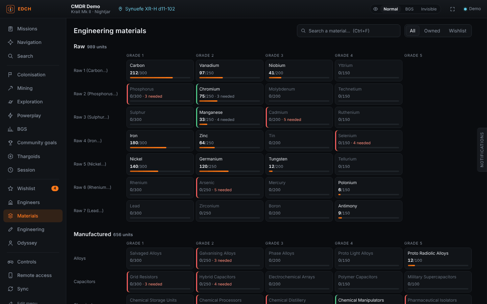
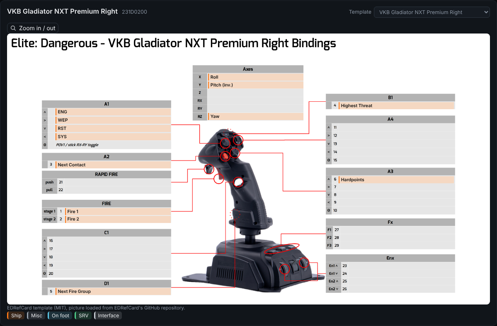

# EDCH — Elite Dangerous Companion Helper

[English](README.md) · [Français](README.fr.md) · [Deutsch](README.de.md) · [Español](README.es.md) · **Português (Brasil)** · [Русский](README.ru.md)

Um companheiro leve para **Elite Dangerous** (Windows). Ele lê o diário do jogo em tempo real e, para cada material de engenharia, mostra **onde encontrá-lo, com sistemas reais e clicáveis ao seu redor**.



## O que ele faz

- **Inventário ao vivo**: materiais brutos, manufaturados e codificados, organizados como no comerciante de materiais (uma linha por família, graus 1 a 5) com indicador de armazenamento. O armário da nave do Odyssey (dados, componentes, itens, consumíveis) é lido do `ShipLocker.json`.
- **Onde encontrar, com sistemas reais**: cada condição de surgimento vira uma busca no [Spansh](https://spansh.co.uk) ao redor da sua posição.
  - HGE: sistemas povoados em Prosperidade/Expansão, Guerra, Agitação civil, Surto, da Federação ou do Império. Estados de facção antigos demais são ignorados.
  - Emissões codificadas conforme a segurança, zonas de conflito, rastros de alta energia.
  - Planetas onde se pode pousar, ordenados pelo % do material bruto, anéis de gelo ou intocados, sítios Guardiões e Thargoid.
  - Assentamentos do Odyssey e locais de farm conhecidos (Jameson, Dav's Hope, brain trees, cristais…).
  - Clique em um sistema: ele é copiado, pronto para colar no mapa da galáxia. Ao lado, links para Spansh e Inara.
- **Comerciante de materiais mais próximo** do tipo certo, com **sugestões de troca** calculadas sobre o seu estoque (taxas do jogo, levando em conta o que a sua lista de desejos reserva).
- **Engenharia**: todas as modificações, efeitos experimentais, sínteses, desbloqueios do corretor de tecnologia e melhorias do Odyssey, com o que você já possui.
- **Lista de desejos**: adicione modificações (graus, número de rolagens, quantidade). Ela calcula o que falta e a melhor troca para cobrir.
- **Engenheiros**: status e nível lidos do diário, sistema copiável, distância e condições de desbloqueio marcadas automaticamente quando o diário permite verificá-las (armário do Odyssey, porão, materiais).
- **Importação de builds**: cole ou escolha uma exportação do **EDSY** ou do **Coriolis** (SLEF ou Loadout JSON). Cada módulo modificado e seu efeito experimental vão para a lista de desejos. Você também pode partir da sua nave atual.
- **Busca no estilo Inara**: onde comprar ou vender uma mercadoria (por preço ou distância), uma nave, um módulo (classe e classificação) ou um serviço (Interstellar Factors, corretor de tecnologia, comerciante de materiais…) ao seu redor.
- **Navegação**: alcance de salto da sua nave (vazia, cheia, carregada, agora, carga simulada), rota com impulso de estrelas de nêutrons via Spansh e Fleet Carrier (saltos, trítio e duração, como estimativa rápida ou plano detalhado do Spansh com paradas de reabastecimento).
- **Controles e dispositivos**: lê seus atalhos (predefinição ativa, inclusive predefinições diferentes para nave, SRV e a pé) e desenha cada dispositivo. O teclado é desenhado tecla por tecla (QWERTY, AZERTY ou QWERTZ) e o controle de Xbox ou PlayStation com marcadores numerados. HOTAS, joysticks e controles reconhecidos (cerca de 45 modelos: VKB, Virpil, Thrustmaster, Saitek/Logitech, CH…) aparecem sobre a imagem do modelo, com a ação escrita na caixa de cada botão. Os modelos vêm do EDRefCard e são carregados do repositório dele no GitHub. Para um modelo não reconhecido, você escolhe o mais parecido; senão, aparece um esquema simples de eixos, chapéus e botões. Cada controle tem sua legenda e uma cor por modo, com filtros Nave / SRV / A pé, busca e ficha para imprimir.
- **Backup da configuração**: exporta seus atalhos (e configurações gráficas) para um zip em Documentos\EDCH e os restaura com um clique. Sua configuração atual é salva automaticamente antes de cada importação.
- **Acesso pelo celular**: abra o EDCH no celular ou tablet escaneando um QR code. Um servidor local (desligado por padrão) serve o app na sua rede. Só entram os aparelhos que escanearam o QR code: o IP do PC não basta. "Novo código" desconecta todos os aparelhos. A interface se adapta ao celular (navegação embaixo, painéis em tela cheia) e as alterações na lista de desejos feitas no celular voltam para o PC.
- **Sincronização no estilo EDMC**: envio ao vivo para o **EDDN** (mercados, equipamentos, estaleiros, saltos, escaneamentos, rotas), o **EDSM** e o **Inara** (com sua chave API). As regras do EDDN são respeitadas: dados pessoais removidos, posição conferida, uma mensagem recusada nunca é reenviada, nada do seu histórico.



## Idiomas

O EDCH está disponível nos seis idiomas do jogo: inglês (padrão), francês, alemão, espanhol, português (Brasil) e russo. O instalador pergunta o idioma e o app o adota no primeiro uso. Você pode mudá-lo a qualquer momento em **Configurações → Idioma**. Os nomes de materiais, módulos e controles ficam como no jogo em inglês.

Para adicionar ou corrigir uma tradução, edite `tools/translations_*.txt` (uma linha por texto: `fr ¦ en ¦ de ¦ es ¦ pt ¦ ru`) e depois rode `python3 tools/gen_locales.py`.

## Instalação

Baixe o instalador (`.exe` ou `.msi`) em [Releases](../../releases), ou o `edch.exe` portátil nos artefatos do último build (aba *Actions*). O Windows 10/11 já vem com o WebView2.

No primeiro uso, a pasta do diário é detectada automaticamente (`%USERPROFILE%\Saved Games\Frontier Developments\Elite Dangerous`). Você pode mudá-la em **Configurações**.

## Desenvolvimento

Requisitos: Node 20+, Rust estável e os [pré-requisitos do Tauri](https://tauri.app/start/prerequisites/) para Windows.

```bash
npm install
npm test            # compila a interface e roda os testes (diário, trocas, consultas ao Spansh, EDDN, atalhos)
npm run app:dev     # abre o app
npm run app:build   # instaladores do Windows em src-tauri/target/release/bundle
npm run demo        # só a interface, no navegador, com um diário de exemplo
```

Estrutura:

- `src-tauri/`: backend em Rust (leitura do diário, arquivos JSON do jogo, chamadas HTTP, arquivos de opções e zips, abertura de links). Não contém lógica do jogo.
- `src/`: interface em TypeScript sem framework.
  - `journal.ts`: estado do comandante a partir dos eventos do diário.
  - `sources.ts`: condições de surgimento transformadas em buscas.
  - `spansh.ts`: chamadas e formatação dos resultados.
  - `trade.ts`: taxas do comerciante de materiais.
  - `eddn.ts`, `uploaders.ts`: mensagens do EDDN, EDSM e Inara.
  - `binds.ts`: arquivos `.binds` e nomes dos dispositivos.
  - `i18n.ts`: camada de tradução.
- `tools/gen_data.py`, `tools/gen_binds.py`, `tools/gen_locales.py`: regeneram os dados de `public/` (veja NOTICE).

Um build para Windows roda a cada push em `main`. Para publicar uma versão, envie uma tag como `v0.5.0`: um rascunho de Release é criado.

## Roteiro

- Login da Frontier (cAPI, OAuth) para frota, estoque e Fleet Carrier: é preciso um Client ID da Frontier.
- EDDN: esquemas restantes (codexentry, approachsettlement, fssbodysignals, fsssignaldiscovered…).
- Rota de farm otimizada para a lista de desejos.

## Créditos

Dados: EDCD/FDevIDs e msarilar/EDEngineer (MIT), via dseelinger/d47 (MIT). Nomes dos controles e modelos dos dispositivos: EDRefCard (Richard Buckle, MIT). Buscas: Spansh (EDDN). Elite Dangerous é uma marca da Frontier Developments plc. Ferramenta comunitária não oficial e não comercial. Detalhes em [NOTICE](NOTICE).
