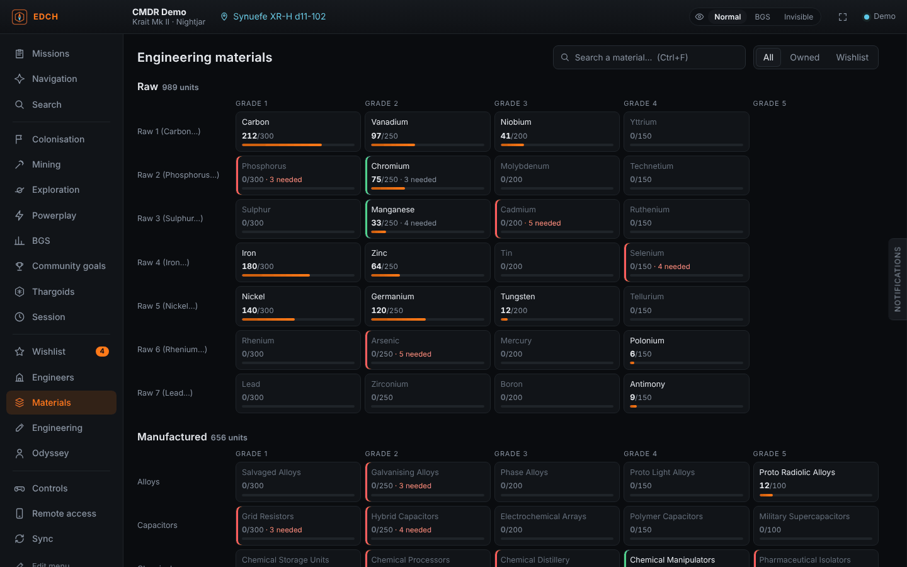
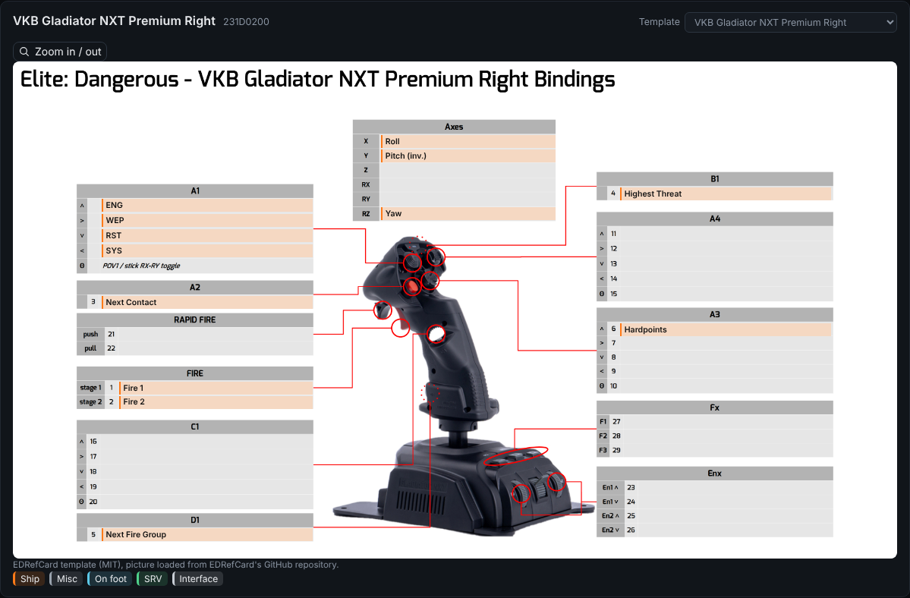
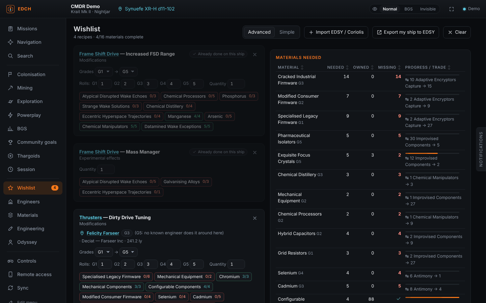
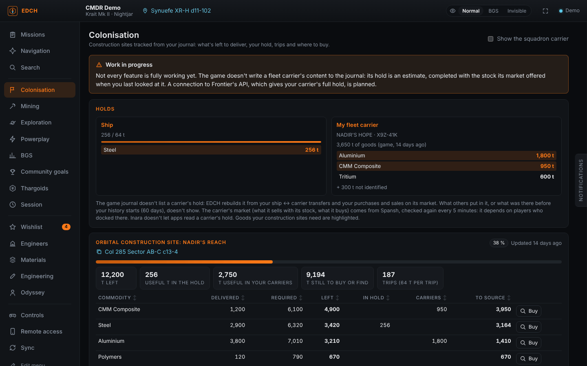
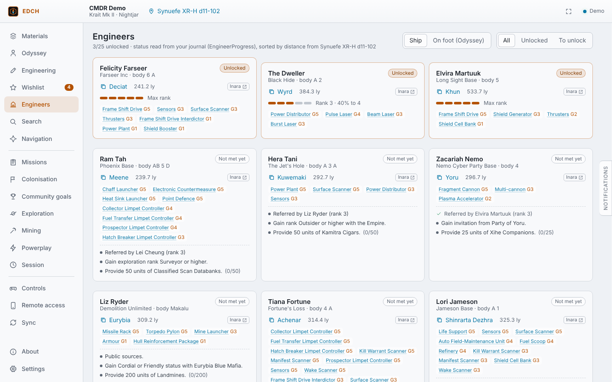
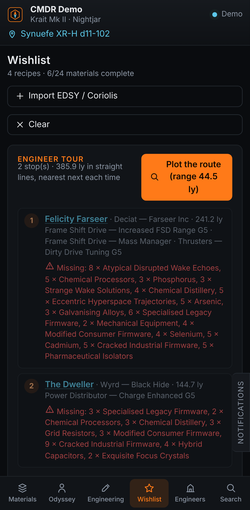

# EDCH — Elite Dangerous Companion Helper

[English](README.md) · [Français](README.fr.md) · [Deutsch](README.de.md) · [Español](README.es.md) · [Português (Brasil)](README.pt-BR.md) · **Русский** · [Code signing policy (политика подписи)](CODE_SIGNING_POLICY.md)

Лёгкий помощник для **Elite Dangerous** (Windows). Он читает журнал игры в реальном времени и для каждого инженерного материала показывает, **где его найти — с реальными системами рядом с вами, по которым можно кликнуть**.

## ⚠️ Прочтите перед использованием

**EDCH не заменяет другие инструменты сообщества.** Это независимый проект, не связанный с [EDMarketConnector](https://github.com/EDCD/EDMarketConnector), [Odyssey Materials Helper](https://github.com/jixxed/ed-odyssey-materials-helper), [EDEngineer](https://github.com/msarilar/EDEngineer), Inara, Spansh или другими проектами и не аффилированный с Frontier Developments. Если вам подходит один из этих инструментов, продолжайте им пользоваться: они старше, полнее и проверены тысячами игроков.

**EDCH в основном написан ИИ (Claude от Anthropic) под контролем разработчика**, который определяет функции, тестирует и утверждает каждую версию. Поэтому инструмент может быть неполным, содержать ошибки или неточные данные. Если найдёте их, откройте [issue](../../issues).

**EDCH не работал бы без труда других людей.** Данные, переводы и поиск взяты из проектов, которые создают и поддерживают добровольцы сообщества: Spansh, EDDN и EDCD, EDSM, Inara, EDEngineer, Odyssey Materials Helper, Elite Dangerous Almanac, EDRefCard, EDSY, Coriolis… Если EDCH вам полезен, поблагодарите их, поддержите или внесите вклад в их проекты. Подробности в разделе [Благодарности](#благодарности) и в файле [NOTICE](NOTICE).



## Возможности

- **Инвентарь в реальном времени**: сырьё, изготовленные материалы и закодированные данные, разложенные как у торговца материалами (строка на семейство, классы 1–5), с индикатором заполнения. Шкафчик корабля из Odyssey (данные, компоненты, предметы, расходники) читается из `ShipLocker.json`.
- **Где найти — с реальными системами**: каждое условие появления превращается в поиск [Spansh](https://spansh.co.uk) вокруг вашего местоположения.
  - HGE: населённые системы в состоянии бума/экспансии, войны, гражданских беспорядков, эпидемии, системы Федерации или Империи. Слишком старые состояния фракций игнорируются.
  - Закодированные излучения по уровню безопасности, зоны конфликта, высокоэнергетические следы.
  - Планеты с возможностью посадки, отсортированные по % сырья, ледяные и нетронутые кольца, объекты Стражей и таргоидов.
  - Поселения Odyssey и известные места фарма (Jameson, Dav's Hope, brain trees, кристаллы…).
  - Клик по системе копирует её название — его можно сразу вставить в карту галактики. Рядом ссылки на Spansh и Inara.
- **Ближайший торговец материалами** нужного типа и **варианты обмена**, рассчитанные по вашему запасу (курсы игры с учётом того, что зарезервировано в списке желаний).
- **Инженерия**: все модификации, экспериментальные эффекты, синтез, открытия у технологического брокера и улучшения Odyssey — с тем, что у вас уже есть.
- **Список желаний**: добавляйте модификации (классы, число бросков, количество). Он считает, чего не хватает, и лучший обмен, чтобы это покрыть. Для каждой строки показан ближайший известный инженер, который может её выполнить, а **маршрут по инженерам** связывает остановки маршрутом Spansh, показывает недостающие на каждой остановке материалы и по желанию копирует следующий прыжок сразу по прибытии. Строки продвигаются сами, когда игра применяет модификацию.
- **Инженеры**: статус и ранг из журнала, копируемая система, расстояние и условия открытия, которые отмечаются автоматически, когда журнал позволяет их проверить (шкафчик Odyssey, трюм, материалы).
- **Импорт сборки**: вставьте или выберите экспорт **EDSY** или **Coriolis** (SLEF или Loadout JSON). Каждый модифицированный модуль и его экспериментальный эффект попадают в список желаний. Можно также начать с текущего корабля.
- **Поиск в стиле Inara**: где купить или продать товар (по цене или расстоянию), корабль, модуль (класс и рейтинг) или услугу (Interstellar Factors, технологический брокер, торговец материалами…) рядом с вами.
- **Навигация**: дальность прыжка вашего корабля (пустой, заправленный, загруженный, сейчас, моделируемый груз), маршрут с нейтронным ускорением через Spansh и корабль-носитель (прыжки, тритий и время — быстрая оценка или подробный план Spansh с точками дозаправки).
- **Управление и устройства**: читает ваши назначения (активный пресет, в том числе разные пресеты для корабля, SRV и пешком) и рисует каждое устройство. Клавиатура рисуется по клавишам (QWERTY, AZERTY или QWERTZ), геймпад Xbox или PlayStation — с пронумерованными метками. Распознанные HOTAS, джойстики и геймпады (около 45 моделей: VKB, Virpil, Thrustmaster, Saitek/Logitech, CH…) показываются на изображении модели, с действием в ячейке каждой кнопки. Шаблоны взяты из EDRefCard и загружаются из его репозитория на GitHub. Для нераспознанной модели можно выбрать ближайший шаблон, иначе показывается простая схема осей, хаток и кнопок. У каждой команды есть подпись и цвет по режиму, фильтры «Корабль / SRV / Пешком», поиск и лист для печати. Выберите свою клавиатуру (AZERTY, QWERTY или QWERTZ) и её формат (ISO или ANSI).
- **Резервная копия конфигурации**: экспортирует назначения (и настройки графики) в zip в Документы\EDCH и восстанавливает их в один клик. Перед каждым импортом текущая конфигурация сохраняется автоматически.
- **Миссии**: все текущие миссии с целью, пунктом назначения, оставшимся временем и прогрессом; стопки миссий на истребление с числом уничтожений, нужных каждой фракции-заказчику.
- Для миссий снабжения и добычи: где достать товар — станции по цене, расстоянию и свежести рыночных данных, с оценкой прибыли, и ближайшие горячие точки для миссий на добычу.
- **Общие миссии звена**: участники звена с EDCH вводят один код и видят, кто принял какую общую миссию: вы сами выбираете, какими миссиями делиться (или всеми автоматически). Сообщения идут через ntfy.sh со сквозным шифрованием этим кодом. Звук и/или мигающая боковая вкладка (без всплывающих окон Windows) сообщают, когда у кого-то есть миссия, которой нет у вас, или когда всё звено её приняло.
- **Колонизация**: каждое строительное депо с тем, что осталось доставить, что у вас в трюме, числом рейсов и поиском в один клик, где купить каждый товар.
- **Цели сообщества**: ваш вклад, категория награды и уровень целей, в которых вы участвуете; все текущие цели через Inara с вашим API-ключом.
- **Исследование**: стоимость непроданных картографических данных, помощь со сбором экзобиологических образцов (расстояние до предыдущих образцов по сравнению с радиусом колонии), возможные виды и стоимость для каждой планеты с биосигналами, непроданные анализы.
- **Добыча**: результаты разведчиков в реальном времени с оповещениями о ваших целях и ядрах, тоннаж за сессию; поиск в стиле Merit Miner, где добывать и продавать в системах вашей державы.
- **Powerplay и сессия**: заслуги за неделю и сессию, состояние Powerplay текущей системы; заработанные кредиты по видам деятельности с момента входа.
- **Удалённый доступ**: откройте EDCH на телефоне или планшете, отсканировав QR-код. Локальный сервер (по умолчанию выключен) раздаёт приложение в вашей сети. Доступ получают только устройства, отсканировавшие QR-код: одного IP ПК недостаточно. «Новый код» отключает все устройства. Интерфейс адаптируется к телефону (навигация внизу, панели на весь экран), а изменения списка желаний на телефоне синхронизируются с ПК. Также может открыть отдельную страницу в браузере для второго экрана, а полноэкранный режим показывает только текущую страницу.
- **Темы**: готовые темы (включая светлую «День»), свои цвета и режим OLED. Слишком светлые или тёмные для чтения цвета подстраиваются автоматически.
- **Автообновление**: EDCH проверяет на GitHub, вышла ли новая версия, показывает баннер, по запросу скачивает установщик (с проверкой контрольной суммы) и перезапускается, чтобы завершить обновление. Отключается в настройках.
- **Синхронизация как в EDMC**: отправка в реальном времени в **EDDN** (рынки, снаряжение, верфи, прыжки, сканы, маршруты), **EDSM** и **Inara** (с вашим API-ключом). Правила EDDN соблюдаются: личные данные удаляются, местоположение перепроверяется, отклонённое сообщение никогда не отправляется повторно, история не отправляется.



<p>


</p>
<p>


</p>

## Данные и конфиденциальность

EDCH читает журнал игры на вашем ПК. Вот всё, что с него уходит, и куда:

- **Spansh**: ваши поисковые запросы (система, материал, товар…) и ваше местоположение как точка отсчёта.
- **EDDN** (включено по умолчанию, как в EDMC; отключается в «Синхронизации»): данные рынков, снаряжения, верфей, прыжков и сканов без ваших личных данных, как требует EDDN.
- **EDSM и Inara**: ничего, пока вы не введёте свой API-ключ в «Синхронизации». Ключи остаются на вашем ПК.
- **ntfy.sh** (только если включён обмен в звене): ваши миссии звена, зашифрованные кодом звена до отправки с ПК.
- **GitHub**: только для проверки новой версии (можно отключить в настройках).
- **Удалённый доступ**: остаётся в вашей локальной сети; по умолчанию выключен и защищён QR-кодом.

Больше ничего не собирается и не отправляется. Настройки, ключи и список желаний хранятся в `%LOCALAPPDATA%\EDCompanionHelper`.

## Языки

EDCH доступен на шести языках игры: английский (по умолчанию), французский, немецкий, испанский, португальский (Бразилия) и русский. Установщик спрашивает язык, и приложение использует его при первом запуске. Сменить язык можно в любой момент в **Настройки → Язык**. Названия материалов, модулей, чертежей и эффектов следуют переводу игры; названия команд остаются как в английской версии.

Чтобы добавить или исправить перевод, отредактируйте `public/locales/<язык>.json` (эталон — английский); см. [docs/TRANSLATING.md](docs/TRANSLATING.md). `npm run i18n:check` покажет недостающие тексты.

## Установка

Скачайте установщик (`.exe` или `.msi`) в [Releases](../../releases) или портативную версию `EDCH_<version>_x64-portable.exe`: без установки, запускается из любой папки (сообщает о новой версии и открывает страницу релиза). В Windows 10/11 WebView2 уже установлен.

**Linux** (Steam/Proton, включая Steam Deck): в каждом релизе также есть `.AppImage` (любой дистрибутив: сделайте файл исполняемым и запустите), `.deb` (Debian, Ubuntu, Mint, Pop!_OS), `.rpm` (Fedora, openSUSE), `PKGBUILD` для Arch Linux и производных (`makepkg -si` в папке, где вы его сохранили) и экспериментальный `.flatpak` (`flatpak install EDCH_….flatpak`). EDCH сам находит журнал в папке Proton в Steam. В Linux обновления не устанавливаются автоматически: EDCH открывает страницу релиза.

EDCH ведёт журналы своей работы (Настройки → Журналы приложения, с кнопкой открытия папки). Режим отладки пишет отдельный подробный журнал, который можно приложить к сообщению об ошибке.

Установщик не подписан цифровой подписью (сертификат дорог для бесплатного инструмента), поэтому Windows SmartScreen при первом запуске может показать «Система Windows защитила ваш компьютер». Нажмите **Подробнее**, затем **Выполнить в любом случае**. Следующие обновления EDCH предложит сам.

При первом запуске папка журнала определяется автоматически (`%USERPROFILE%\Saved Games\Frontier Developments\Elite Dangerous`). Её можно изменить в **Настройках**.

## Разработка

Требования: Node 20+, стабильный Rust и [требования Tauri](https://tauri.app/start/prerequisites/) для Windows.

```bash
npm install
npm test            # собирает интерфейс и запускает тесты (журнал, обмен, запросы Spansh, EDDN, назначения)
npm run app:dev     # запускает приложение
npm run app:build   # установщики Windows в src-tauri/target/release/bundle
npm run demo        # только интерфейс в браузере, с примером журнала
```

Структура:

- `src/`: интерфейс на TypeScript без фреймворка, по слоям (platform, game, state, ui, services, features, views, app); `src-tauri/`: бэкенд на Rust (журнал, HTTP, файлы настроек, сервер удалённого доступа, обновления), без игровой логики. См. [docs/ARCHITECTURE.md](docs/ARCHITECTURE.md) и [CONTRIBUTING.md](CONTRIBUTING.md) (на английском).
- `tools/gen_data.py`, `tools/gen_binds.py`, `tools/gen_game_locales.py`: заново создают данные в `public/` (см. NOTICE).

Сборка для Windows запускается при каждом push в `main`. Чтобы выпустить версию, отправьте тег, например `v0.10.9`: Release будет опубликован, а установленные копии предложат обновление.

## Планы

- Вход через Frontier (cAPI, OAuth) для флота, запасов и корабля-носителя: нужен Client ID от Frontier.
- EDDN: оставшиеся схемы (codexentry, approachsettlement, fssbodysignals, fsssignaldiscovered…).
- Оптимальный маршрут фарма для списка желаний.

## Поддержать EDCH

EDCH бесплатен, без рекламы, и таким останется. Его задумывает, тестирует и поддерживает CMDR MDLuffy, а разрабатывает с помощью ИИ Claude (Anthropic). Если он вам полезен, вы можете поддержать проект на [Ko-fi](https://ko-fi.com/bknadir): это оплачивает инструменты (подписку на ИИ), время на тесты и исправления и со временем подпись приложения.

## Благодарности

Данные: EDCD/FDevIDs и msarilar/EDEngineer (MIT) через dseelinger/d47 (MIT). Переведённые названия из игры: Elite Dangerous Almanac (MIT) и EDEngineer. Названия команд и шаблоны устройств: EDRefCard (Richard Buckle, MIT). Поиск: Spansh (EDDN). Elite Dangerous — товарный знак Frontier Developments plc. Неофициальный некоммерческий инструмент сообщества. Подробности в [NOTICE](NOTICE).
